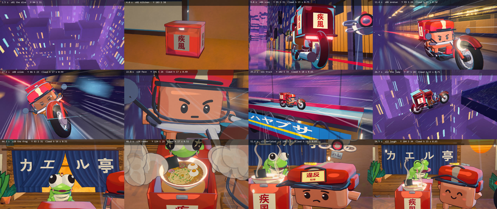
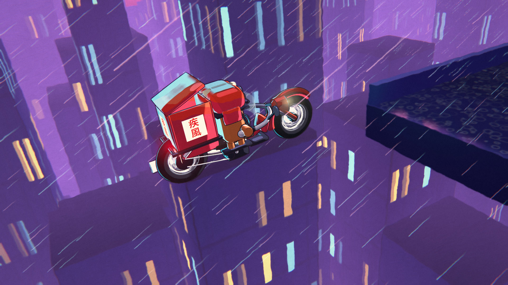
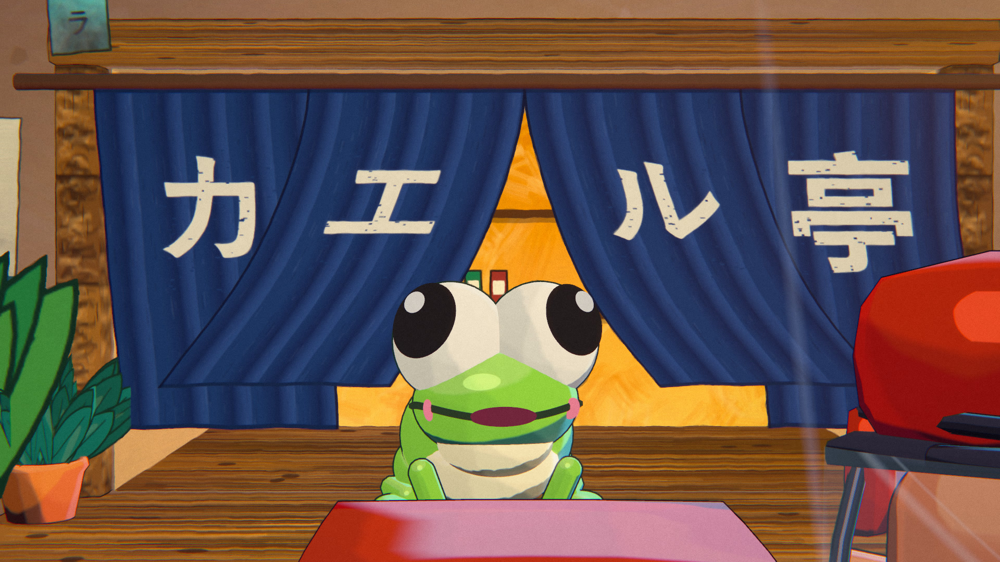
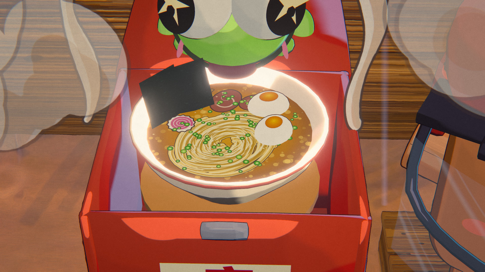
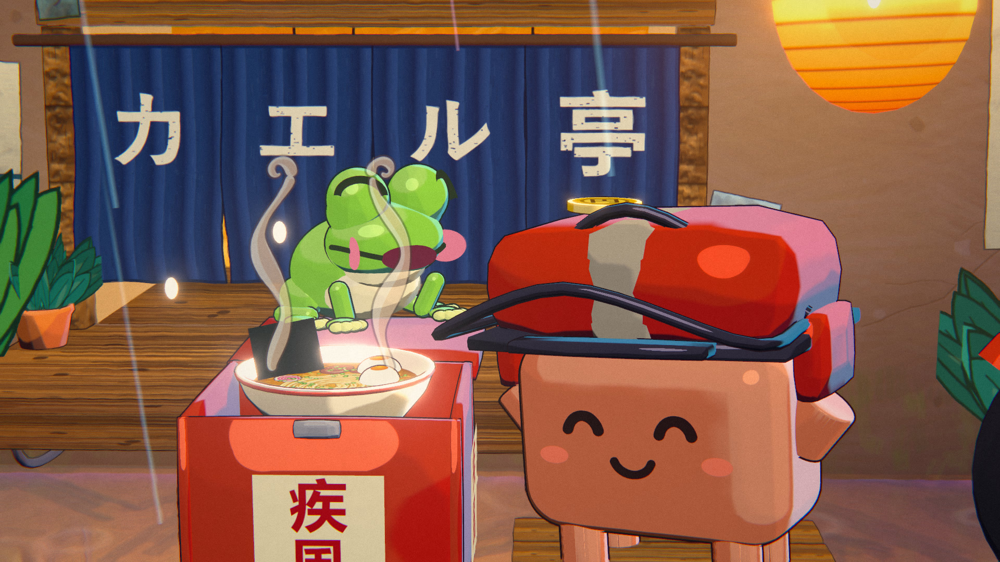

# HAYATE · 疾風

A 58-second anime short rendered entirely by code: no video model, no image model, no hand-drawn frames. Made with Fable 5.5.



**Watch:** download [`dist/hayate.html`](dist/hayate.html) and open it in Chrome, Edge or any browser with WebGL2 and a GPU. One
self-contained file (5.5 MB): the player renders the film live at 1920×1080 with the soundtrack inlined, and works offline.

> An original short, series **Fable 5.5 Anime Lab**. The production brief is [BRIEF.md](BRIEF.md).

| | |
|---|---|
|  |  |
|  |  |

---

## The story

A neon night city after rain. A bowl of ramen goes into a red box, Clawd kicks his delivery bike alive, and a traffic drone
writes him up. He launches anyway. Hundreds of drones pour out of the alleys: a power slide around a corner, trucks missing him
by inches, a ramp, a jump across the gap between two expressways, a tunnel, an arcade, a staircase, a steel shutter he slides
under with the drones slamming into it behind him. Sudden quiet. He rolls up to a tiny noodle hatch and stops exactly on the
chalk mark. The noren parts, the frog from our film Ame peeks out, hops up, and pulls one long noodle in a whipping slurp, then
tips him a coin with its tongue. One last tiny drone sinks down through the rain and sticks a parking ticket on his helmet. He
deflates. The frog eats the ticket and burps. The drone flees. They laugh.

## Why it looks like anime

The film is one three.js (r160, WebGL2) scene drawn through an anime look kit (`src/anime.js`) that imitates a cel +
painted-background production:

| Pass | What it does |
|---|---|
| mirror | half-resolution planar reflection for the wet asphalt: sharp in the puddles, smeared on the road |
| main (MSAA) | every material writes a paint mask in alpha: 1 = painted background, 0 = clean cel layer (characters, ink, lettering) |
| speed | radial or directional smear on the background only, never on the characters |
| paint | anisotropic Kuwahara "gouache" filter on the background, pigment variation, brush texture |
| bloom / grade | glow on neon and lanterns, halation, tone knee, split tone, grain |
| FX | speed lines, impact frames (ramped in and out, so they read without strobing) |

* **Cel characters.** Clawd is a sculpted vinyl-toy mascot with a library of facial expressions, three hard tone bands, a 3 px
  ink line and a small shaped highlight. A palette lock plus a small hue trim per shot keeps him terracotta under pink and cyan
  neon: body hue 13.4–17.6 in every sampled frame.
* **On twos.** Clawd and the frog move at 12 drawings a second; the camera, the rain and the speed FX move on ones.
* **The nook is painted.** The last 13 seconds happen in `src/nook.js`: the wall is one big gouache plate painted in a canvas
  (bristle strokes, exposed brick, stains running down from the awning, moss at the foot, the lamplight painted right in) and
  everything with depth is a prop in front of it: a wooden hatch frame and ledge, a noren curtain whose middle panels part around
  the frog, a tin awning dripping in warm light, a paper lantern, potted plants, posters and stickers in made-up katakana, a
  drainpipe and a meter box. The steam is drawn: curling cel plumes on threes with a bold outline, cumulus puffs that bloom
  past both faces and clear. The ramen is drawn with love: broth, a noodle nest, chashu, egg, nori, narutomaki, menma, scallions.
* **Acting.** Anticipation, overshoot, settle on every beat: the crouch before the hop, the lid that flips and bounces on the
  ledge, the bowl that rises on a spring tray, cheeks that balloon around a slurping noodle, a body that melts with joy, a coin
  that lands with a bounce on a helmet, a long held beat of a deflated courier, a tongue that takes the ticket back.
* **Every frame is a pure function of its index.** No `Math.random`, no clock, no carried state: frames render in any order, so
  the headless render is resumable and deterministic.
* **Sound is fully synthesized** with Web Audio `OfflineAudioContext`, no samples: a pitched engine that follows the speed
  curve, an original track with taiko and a gritty lead, dead silence at the top of the jump; then dripping on a tin awning,
  soft rain, the engine ticking and cooling, a far muffled city, a tiny lo-fi koto and rhodes melody that blooms as the lid opens,
  ceramic clink, steam hiss, a long comic slurp with rising pitch, a happy croak melody, a coin ting, the ticket's sticky peta, a
  sad falling synth, tongue thwip, gulp, a tiny burp croak, a drone yelp, and a warm cadence that lands on their laugh.

Numbers: 23 shots, 1392 frames at 24 fps, 1920×1080, about 0.25 s per frame at 1080p on an RTX 2060 with the PNG write (about 6
minutes for the whole film), about 2,300 dense lines of code (the film 148 KB, the nook 40 KB, the look kit 127 KB, the synth 33 KB).

## How it was made

Fable 5.5 in Claude Code, one agent, from a production brief ([BRIEF.md](BRIEF.md)). The agent built the city, the bike, the drones and
the frog's face rig in code on top of the anime kit from Ame, painted the nook in canvas, wrote the score as a synth, and wrote the
tools in `tools/`. A viewer watched the draft and asked for one thing: make the scene at the end with the frog more alive and
original, in the look and the sound, and let nothing clip. The ending was rebuilt from scratch and the riding shots got new cameras.

Before every render the agent checked its own work: labelled keyframes with measured luma, saturation and Clawd's body hue (a
mask pass that isolates the body from bars and visor, then eroded); a collision script that poses every second frame and tests every
prop vertex against Clawd's body, nubs and legs; a QC pass over the encoded film (luma per frame, jumps on cuts, blank, identical and
near-duplicate frames); a loudness and true-peak report for the sound. Native 1920×1080 frames were inspected shot by shot.

Final numbers: 600 posed frames, 0 collisions between any prop (bars, grips, box, visor, ramen, frog, tongue, noodle, coin, ticket, drone) and
Clawd · luma mean 96.8 (0–255); the only frame-to-frame jumps above 25 are the two ramped impact frames · 0 blank and 0 identical frames ·
Clawd's body hue 13.4–17.6 · soundtrack −14 LUFS, −2.1 dBTP after AAC.

## Run it

Requirements: Node 20+, a GPU with WebGL2 (the tools refuse a software renderer unless you pass `--allow-sw`), `ffmpeg` + `ffprobe` on
`PATH` for the sound and the encode (`FFMPEG=` / `FFPROBE=` override them). Chromium comes with Playwright (or set `CHROME=/path/to/chrome`).

```bash
npm install
npx playwright install chromium
```

**Live.** `npm run serve` serves the repo on `http://127.0.0.1:9100/`, where `index.html` shows one frame of the film per URL:

| URL | What |
|---|---|
| `/?f=1116` | a frame (1116 = the ramen, 46.5 s) |
| `/?t=25.2` | a time in seconds |
| `/?render=1` | no frame on load: the tools call `window.renderFrame(t)`, which returns the frame as a data URL |
| `/audio.html` | the soundtrack synth (driven by `tools/sound.mjs`) |

**Full build.** Soundtrack, film (resumable PNG frames), the single-file player, the encode:

```bash
npm run build
```

`npm run build` = `npm run audio` (`sound.mjs` → `master.mjs`) → `npm run render` (1392 PNG frames in resumable chunks of 150) →
`npm run player` (`dist/hayate.html`) → `npm run encode` (`draft_qc.mjs`: H.264 + QC, then `master.mjs`: the AAC mux). Work files go to
`WORK` = `HAYATE_WORK` if set, else `<temp>/hayate-work`. Only the player lands in the repo (`dist/`).

**Checks.**

```bash
npm run collide           # clipping check, per shot
node tools/spectrum.mjs   # sound: power in 6 bands per section
```

| Tool | What |
|---|---|
| `tools/render.mjs` | `stills --times …` or `film` → PNG / JPEG frames in chunks of 150, resumable (`--from --to --fmt --out`) |
| `tools/sound.mjs` | the film's cue list → `audio.html` → `WORK/sound/raw.wav` (48 kHz float) |
| `tools/master.mjs` | −14 LUFS, oversampled true-peak limiter → `master.wav` + `soundtrack.m4a`; muxes the video |
| `tools/draft_qc.mjs` | frames → H.264 High, yuv420p, BT.709, 24 fps CFR; QC: sheet, luma scan, jumps, blank / identical / near-duplicate frames |
| `tools/build-player.mjs` | `dist/hayate.html`: every module, the mascot and the soundtrack inlined, plays from `file://` |
| `tools/keys.mjs` | labelled keyframes with luma / saturation / body hue, contact sheet |
| `tools/probe.mjs` + `tools/collide.js` | run JS in the film page; the collision check |

## Layout

```
index.html           the film in a browser, one frame per URL (import map -> vendor/three, no CDN)
audio.html           the soundtrack synth (Web Audio, no samples)
BRIEF.md             the production brief: shots, cues, designs, look rules, sound, quality gates
LICENSE              MIT
src/hayate.js        the film: sets, bike, drones, frog, staging, cameras, sound cues
src/nook.js          the hand-painted noodle hatch, the ramen, the drawn steam
src/anime.js         the anime look kit: light rig, cel + paint materials, ink, neon, rain, wet ground, post, end card
src/clawd/           the mascot: loader, glTF model, emotion library
tools/               render, sound, master, draft_qc, build-player, keys, probe + collide, spectrum, sheet, serve
player/player.html   the single-file player template
dist/hayate.html     the built single-file player
docs/                keyframes.jpg, stills/
vendor/three/        three.js r160 (only the files the film imports, MIT)
```

## License

MIT © 2026 seeconever, see [LICENSE](LICENSE). three.js is MIT (`vendor/three/LICENSE`).
Series: Fable 5.5 Anime Lab.
